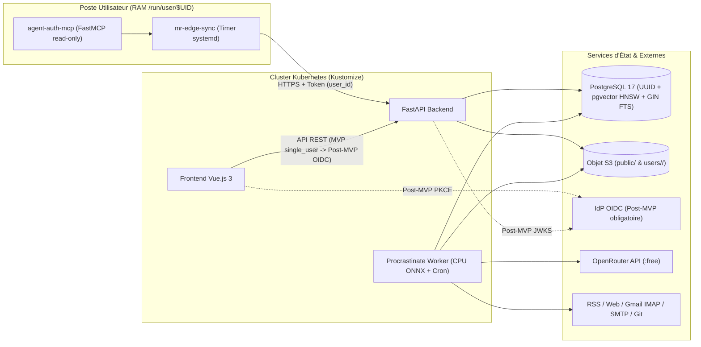
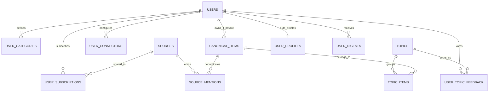

# Architecture Decision Records (`adr.md`)

Ce document consigne les décisions d'architecture structurantes du projet **Morning Review** ainsi que les documentations officielles vérifiées qui les justifient.

---

## ADR-001 : Architecture Produit Simple & Unifiée (FastAPI + Procrastinate sur PostgreSQL + Vue.js 3)

### Contexte
Le système doit agréger périodiquement des flux hétérogènes, exécuter des traitements texte/vectoriels sur CPU, interroger des LLM externes sous contrainte de débit, servir une application Web persistante évolutive vers le multi-utilisateurs et tourner sur Kubernetes sans multiplier les composants d'infrastructure (pas de cluster Redis, RabbitMQ, ni Elasticsearch dédiés).

### Décision
La plateforme repose sur **3 briques applicatives légères** et **2 briques d'état** déjà maîtrisées :
1. **`backend-api` (Python 3.12+ / `uv` / `FastAPI` / `SQLAlchemy 2.0`)** : API REST stateless exposant la lecture des rapports, l'exploration des sujets, la recherche hybride, le feedback d'auto-profilage, l'administration des sources et l'endpoint d'ingestion Edge.
2. **`backend-worker` (`Procrastinate` sur PostgreSQL)** : Processus Python partageant le même code métier que l'API, exécutant à la fois les tâches planifiées (`@app.periodic` cron : relève RSS/IMAP, génération matinale des rapports) et les files de jobs asynchrones (extraction texte, embeddings ONNX CPU, clustering, synthèse OpenRouter, envoi mail et push Git) via les verrous natifs PostgreSQL (`SELECT ... FOR UPDATE SKIP LOCKED`).
3. **`frontend-web` (`Vue.js 3` + `Vite` + `TypeScript` + `Pinia`)** : SPA servie par un conteneur Nginx non-privilégié pour la consultation persistante des rapports quotidiens, la recherche et le profilage.
4. **Stockage d'état** : **PostgreSQL 16/17** (avec `pgvector`) + **Stockage Objet compatible S3**.

### Références officielles
- [Astral `uv` — Project Structure & `pyproject.toml`](https://docs.astral.sh/uv/concepts/projects/layout/)
- [FastAPI Official Documentation](https://fastapi.tiangolo.com/)
- [Procrastinate — PostgreSQL-based Task Queue & Periodic Cron](https://procrastinate.readthedocs.io/en/stable/howto/basics/periodic.html)
- [Vue.js 3 Official Documentation](https://vuejs.org/)

---

## ADR-002 : Séparation Stockage Relationnel/Vectoriel (PostgreSQL) et Stockage Texte Adressable par Contenu (S3)

### Contexte
Stocker l'intégralité des HTML bruts, newsletters et articles longs directement dans les lignes PostgreSQL alourdit la table (TOAST bloat, sauvegardes volumineuses, cache RAM dégradé), tandis que stocker les métadonnées uniquement sur S3 interdit le requêtage relationnel rapide et la recherche hybride. En outre, les articles publics ne doivent pas être dupliqués lorsque d'autres utilisateurs rejoindront la plateforme, tandis que les contenus payants ou personnels doivent être isolés par `user_id`.

### Décision
1. **PostgreSQL** conserve : les métadonnées normalisées (titre, auteur, URL canonique, dates, compteurs), un extrait court (`excerpt` $\le 600$ caractères), les vecteurs d'embeddings (`halfvec(384)`), la colonne d'indexation plein texte (`tsvector`), le graphe des sujets (`topic_id`) et les pointeurs `s3_key`.
2. **Stockage Objet compatible S3** (piloté via `boto3` avec `endpoint_url` / `AWS_ENDPOINT_URL_S3` et `addressing_style="path"` ou `"virtual"`) stocke les textes complets normalisés en Markdown :
   - **Espace public dédoublonné par contenu (CAS)** :
     `public/items/<sha256[0:2]>/<sha256>.md` — partagé entre tous les utilisateurs abonnés à la même source publique.
   - **Espace privé cloisonné par `user_id` (`UUID`) dès le MVP** :
     `users/<user_id>/items/<sha256[0:2]>/<sha256>.md` — réservé aux emails Gmail, aux articles issus d'abonnements payants (*Pour la Science*, *New Scientist*, *Canard PC*, *Medium*) et aux recommandations sociales personnelles.
   - **Archives des rapports quotidiens par `user_id`** :
     `users/<user_id>/digests/<YYYY>/<MM>/<YYYY-MM-DD>.md`.

### Références officielles
- [Boto3 S3 Service Reference & Custom `endpoint_url`](https://boto3.amazonaws.com/v1/documentation/api/latest/reference/services/s3.html)

---

## ADR-003 : Modèle de Données Multi-Sources (`topic_id` UUID) & Prêt Multi-Utilisateurs dès le MVP (`user_id` UUID non auto-incrémenté)

### Contexte
1. Une même actualité est fréquemment couverte simultanément par plusieurs sources (ex: 2 flux RSS tech, 3 newsletters Gmail, un fil X et un article abonné). L'utilisateur a besoin d'un **identifiant unique de sujet (`topic_id`)** regroupant toutes ces sources.
2. Bien que le système démarre avec un **seul utilisateur au MVP**, le modèle de données doit accepter nativement de futurs utilisateurs par la suite sans migration destructive : toutes les entités dépendant de l'utilisateur doivent porter dès le départ un **`user_id` unique et non auto-incrémenté**, tout en mutualisant le catalogue de sources publiques.

### Décision
#### 1. Identifiants Universels Non Auto-Incrémentés (`UUID` 128 bits)
- **Interdiction de `SERIAL` / `BIGSERIAL` / `IDENTITY`** sur `users` et sur les entités métier : toutes les clés primaires et étrangères structurantes (`user_id`, `topic_id`, `item_id`, `source_id`, `digest_id`) utilisent le type natif PostgreSQL **`UUID`** (128 bits, RFC 9562 — UUIDv7 ordonné temporellement ou UUIDv4 aléatoire).
- La table `users` inclut dès le schéma initial :
  - `id UUID PRIMARY KEY` (`user_id` immuable interne, ex: `BOOTSTRAP_USER_ID` en MVP),
  - `email TEXT UNIQUE`,
  - `oidc_issuer TEXT NULL`, `oidc_sub TEXT NULL` avec contrainte `UNIQUE (oidc_issuer, oidc_sub)` prête pour l'accostage OIDC futur.

#### 2. Séparation Entités Mutualisées vs Entités Portant `user_id`
- **Entités publiques mutualisées** (pas de duplication inter-utilisateurs) :
  - `sources` (`id UUID`, `kind`, `feed_url UNIQUE`, `site_url`, `is_public BOOLEAN`) : un flux RSS public n'existe et n'est collecté qu'une seule fois.
  - `topics` (`id UUID PRIMARY KEY`) : **Sujet unique** regroupant $1..N$ `canonical_items` via `topic_items(topic_id, item_id, similarity_score, source_role)`.
- **Entités hybrides (publiques ou privées)** :
  - `canonical_items` (`id UUID`, `visibility IN ('public', 'private')`, `user_id UUID NULL REFERENCES users(id)`) : `user_id` vaut `NULL` pour un article public mutualisé, et contient le `user_id` propriétaire pour tout contenu privé (email Gmail, article sous paywall, recommandation personnelle), avec contrainte `CHECK ((visibility = 'public' AND user_id IS NULL) OR (visibility = 'private' AND user_id IS NOT NULL))`.
  - `source_mentions` (`id UUID`, `source_id UUID`, `item_id UUID`, `user_id UUID NULL REFERENCES users(id)`).
- **Entités strictement rattachées à l'utilisateur (`user_id UUID NOT NULL REFERENCES users(id)`)** :
  - `user_categories` (`id UUID`, `user_id UUID NOT NULL`, `slug`, `name` — ex: `tech`, `perso`, `science`)
  - `user_subscriptions` (`id UUID`, `user_id UUID NOT NULL`, `source_id UUID NOT NULL`, `category_id UUID`, `UNIQUE(user_id, source_id)`)
  - `user_connectors` (`id UUID`, `user_id UUID NOT NULL`, `connector_type`, `encrypted_config`, `allow_external_llm`)
  - `user_api_tokens` (`id UUID`, `user_id UUID NOT NULL`, `token_sha256`, `scopes`)
  - `user_topic_feedback` (`user_id UUID NOT NULL`, `topic_id UUID NOT NULL`, `vote SMALLINT`, `PRIMARY KEY (user_id, topic_id)`)
  - `user_profiles` (`user_id UUID PRIMARY KEY`, `interest_embedding halfvec(384)`, `source_affinities JSONB`)
  - `user_digests` (`id UUID PRIMARY KEY`, `user_id UUID NOT NULL`, `digest_date DATE`, `UNIQUE (user_id, digest_date)`)

#### 3. Algorithme d'affectation déterministe au `topic_id`
1. Si un `canonical_item` pointe vers la même URL primaire citée qu'un item déjà rattaché à un `topic` récent (et visible par le contexte courant), il rejoint ce `topic_id`.
2. Sinon, recherche ANN dans `pgvector` parmi les centroïdes `topics.centroid_embedding` actifs sur une fenêtre glissante (`TOPIC_WINDOW_DAYS=14`). Si la similarité cosinus dépasse `TOPIC_SIMILARITY_THRESHOLD` (`0.84`), l'item rejoint ce `topic_id` et met à jour son centroïde ; sinon un nouveau `topic_id` (UUIDv7) est créé.

### Références officielles
- [PostgreSQL Official Documentation — UUID Data Type (`datatype-uuid`)](https://www.postgresql.org/docs/current/datatype-uuid.html)
- [PostgreSQL Official Documentation — Row Security Policies (`ddl-rowsecurity`, activables Post-MVP)](https://www.postgresql.org/docs/current/ddl-rowsecurity.html)

---

## ADR-004 : Recherche Hybride Native PostgreSQL (`tsvector` GIN + `pgvector` HNSW + Reciprocal Rank Fusion)

### Contexte
L'utilisateur doit pouvoir retrouver a posteriori des sources ou des sujets aussi bien par **mot-clé exact** (nom propre, outil, acronyme technique, numéro CVE) que par **proximité sémantique** (idée formulée différemment, recherche bilingue FR $\leftrightarrow$ EN), dans son périmètre de visibilité (`visibility = 'public' OR user_id = :current_user_id`).

### Décision
Toute la recherche repose nativement sur PostgreSQL en combinant deux index complémentaires fusionnés par **Reciprocal Rank Fusion (RRF)**, sans service externe (ni Elasticsearch, ni moteur vectoriel dédié) :
1. **Recherche lexicale plein texte (`GIN`)** :
   - Colonne `fts tsvector` pondérée (`setweight(..., 'A')` sur le titre, `'B'` sur le résumé et les tags/catégories, `'C'` sur le corps Markdown) combinant les analyseurs `'french'` et `'english'`, indexée par `USING GIN (fts)`.
2. **Recherche vectorielle sémantique approchée (`HNSW` sur `halfvec`)** :
   - Extension `vector` (`pgvector`, fournie nativement par `pgvector/pgvector:pg17` en local et par les extensions `ImageVolume` / catalogue de **CloudNativePG** sur Kubernetes).
   - Stockage en demi-précision **`embedding halfvec(384)`** indexé par `USING hnsw (embedding halfvec_cosine_ops) WITH (m = 16, ef_construction = 64)` : divise par deux l'empreinte mémoire et disque (~**77 Mo** seulement pour 100 000 articles), garantissant que le graphe HNSW tient intégralement dans un `maintenance_work_mem` modeste (256–512 Mo) et dans le même backup PostgreSQL (`pg_dump` / WAL).
3. **Fusion RRF ($k = 60$)** :
   - L'API `/api/v1/search` accepte `mode = hybrid | keyword | semantic` ainsi que des filtres (`category_id`, `date_from`, `date_to`, `source_id`, `only_relevant`). En mode `hybrid`, une requête SQL unique combine les rangs des CTE `semantic_matches` et `lexical_matches` via $\text{score} = \frac{1}{60 + \text{rank}_{\text{sem}}} + \frac{1}{60 + \text{rank}_{\text{lex}}}$.

### Références officielles
- [PostgreSQL Official Documentation — GIN Indexes for Full-Text Search](https://www.postgresql.org/docs/current/textsearch-indexes.html)
- [pgvector Documentation — HNSW Indexing, `halfvec` & Memory (`maintenance_work_mem`)](https://github.com/pgvector/pgvector#hnsw)
- [CloudNativePG Documentation — PostgreSQL Extensions & `pgvector` Containers](https://cloudnative-pg.io/documentation/current/postgres_containers/)

---

## ADR-005 : Ingestion Multi-Sources & Intégration du Projet Frère `agent-auth-mcp`

### Contexte
Les sources visées se répartissent en trois familles aux contraintes techniques très différentes :
1. **Sources ouvertes** : Flux RSS/Atom/JSON Feed, blogs et sites web publics.
2. **Boîtes mail de curation** : Newsletters reçues sur Gmail (identifiants `GMAIL_ACCOUNT` / `GMAIL_PWD` en `.env` rattachés au `BOOTSTRAP_USER_ID` en MVP, puis connecteurs IMAP par `user_id`), où un seul email agrège souvent 5 à 20 sujets distincts.
3. **Abonnements payants (*Pour la Science*, *New Scientist*, *Canard PC*, *Medium*...) et recommandations externes d'accueil (*YouTube Home*, *Spotify Home*, *Twitter/X*, *Facebook*)** :
   - Les APIs publiques officielles n'exposent plus les flux de recommandation algorithmiques d'accueil : le paramètre `home` de `activities.list` est déprécié sur YouTube Data API v3, et Spotify a restreint l'accès aux endpoints `Recommendations` pour les applications tierces en mode développement.
   - Le projet frère `/home/mathieu/dev/projects/perso/agent-auth-mcp` fournit déjà un socle d'authentification Playwright Chrome hors-bande écrivant des jetons de session en RAM (`/run/user/<UID>/agent-tokens/<outil>.token`, permissions `0600`) consommés en pur HTTP (`httpx`) derrière des serveurs **FastMCP** en mode `read-only` (`pourlascience`, `newscientist`, `medium`, `notebooklm`, `notion`, `garmin`).
   - Les cookies anti-bot (ex: Cloudflare `cf_clearance`) capturés par `agent-auth-mcp` sont liés à l'adresse IP résidentielle et au `User-Agent` du poste utilisateur : ils ne doivent ni quitter la RAM locale, ni être rejoués depuis l'IP datacenter d'un cluster Kubernetes.

### Décision
1. **Stratégie en 2 temps (« Public RSS Discovery First $\rightarrow$ On-Demand MCP Deep-Fetch »)** :
   - **Étape 1 — Découverte continue par flux publics (24/7, sans jeton requis)** :
     - Les publications scientifiques et techniques (*New Scientist* via `https://www.newscientist.com/feed/home/`, *Quanta Magazine* via `https://api.quantamagazine.org/feed/`, *Pour la Science* via `https://www.pourlascience.fr/rss.xml`, blogs Cloud/K8s) sont d'abord relevées via leurs **flux RSS publics** (`kind = 'rss'`, `is_public = true`).
     - Cela garantit une découverte autonome, mutualisable entre utilisateurs et insensible à l'expiration des cookies de session, avec attribution immédiate d'un `topic_id` (`UUID`), catégorisation (`science`, `tech`...) et vectorisation `HALFVEC(384)`.
   - **Étape 2 — Enrichissement profond à la demande (`enrich_topic_content` / « Lazy Deep-Fetch »)** :
     - Lorsqu'un sujet (`topic_id`) nécessite d'aller chercher le corps complet de l'article (via `uv run morning-review enrich <topic_id>` ou `POST /api/v1/topics/{topic_id}/enrich`), le module [`mcp_enricher.py`](file:///home/mathieu/dev/projects/perso/morning-review/backend/src/morning_review/connectors/mcp_enricher.py) inspecte le domaine de `primary_url` :
       - Si l'URL correspond à un outil de `agent-auth-mcp` (`newscientist`, `pourlascience`, `medium`) **et** que le jeton éphémère `/run/user/$UID/agent-tokens/<outil>.token` est présent en RAM, il invoque le client authentifié de `agent-auth-mcp` en lecture seule (`mcp_auth:<outil>`) et archive l'article abonné complet sur S3 dans l'espace privé de l'utilisateur (`users/<user_id>/items/...`).
       - Sinon (article en accès libre comme *Quanta Magazine*, ou jeton abonné non ouvert), il extrait le Markdown complet via **`Trafilatura`** (`trafilatura_public`), archive sur S3 (`public/items/...`), détecte d'éventuels marqueurs de paywall et indique la commande exacte d'authentification `agent-auth-mcp` si l'utilisateur souhaite déverrouiller la version abonnée.
2. **Connecteurs Serveur (exécutés par `backend-worker` sur K8s)** :
   - **RSS / Atom / Chaînes YouTube publiques** : `feedparser` + `httpx` avec cache HTTP conditionnel (`ETag` / `Last-Modified`) et `User-Agent` d'agrégateur RSS explicite (`MorningReview/1.0 (RSS Reader; Feed Fetcher)`, accepté sans erreur `406` par le CDN Fastly/Varnish de *New Scientist*), mutualisé une seule fois dans `sources`.
   - **Extraction Web déterministe** : `Trafilatura` (extraction du corps `<article>` en Markdown propre + métadonnées JSON, suppression du boilerplate).
   - **Gmail IMAP & Déplieur de Newsletters de curation** : Connexion TLS `imap.gmail.com:993` (`imaplib` / App Password). Un extracteur déterministe structurel découpe chaque newsletter multi-liens en items unitaires (résolution des URLs de tracking vers l'URL finale + conservation du commentaire du curateur), associés au `user_id` propriétaire.
3. **Synchronisation Hybride en 4 Étapes (`vm-hostinger` $\leftrightarrow$ Poste Local Edge `morning-review sync-edge`)** :
   - **Étape 1 (Collecte serveur `0 * * * *` sur `vm-hostinger`)** : relève continue des flux RSS et des newsletters Gmail. Les articles ouverts (notamment *Long-Form* : *Quanta Magazine*, *Ars Technica*, *Construction Physics*...) sont extraits intégralement par `Trafilatura`. Les articles derrière paywall sont enregistrés avec leur titre, leur URL et leur chapô public.
   - **Étape 2 (File d'attente `GET /api/v1/edge/pending-topics`)** : tout sujet récent issu d'un domaine abonné dont l'objet S3 n'est pas encore sous `enriched/<sha256[:2]>/<sha256>.md` (ou dont la synthèse LLM est absente) est marqué comme « à récupérer ».
   - **Étape 3 (Enrichissement local `uv run morning-review sync-edge`, cron `15 */2 * * *` dans `.agents/schedules.json`)** : lorsque le PC local est allumé, il interroge `/api/v1/edge/pending-topics`, utilise les tokens personnels en RAM (`/run/user/$UID/agent-tokens/*.token`) via `agent-auth-mcp` pour extraire le contenu abonné complet, génère la synthèse LLM (Ollama local / OpenRouter) et pousse le Markdown + le résumé vers `POST /api/v1/edge/push-enrichment` sur `vm-hostinger`. Aucun token personnel ne quitte jamais le poste local.
   - **Étape 4 (Morning Review à `06h30` sur `vm-hostinger`)** : sélectionne au plus **12 sujets inédits (24h)** en excluant strictement tout `topic_id` déjà présenté dans un `UserDigest` antérieur (sauf rebondissement factuel réel validé sémantiquement par le LLM via `_call_llm_novelty_analysis`) et en appliquant un bonus d'autorité (`+0.24`) aux sources *Long-Form* afin qu'elles ne soient jamais enfouies sous les brèves répétitives. La synthèse s'appuie sur le contenu complet (si enrichi par l'Edge ou Trafilatura) ou, à défaut, sur le chapô public croisé avec les autres sources via OpenRouter `:free`.

### Références officielles
- [Trafilatura Official Documentation](https://trafilatura.readthedocs.io/)
- [Python Standard Library — `imaplib` IMAP4 Protocol Client](https://docs.python.org/3/library/imaplib.html)
- [YouTube Data API v3 — `activities.list` (`home` parameter deprecation)](https://developers.google.com/youtube/v3/docs/activities/list)
- [Spotify for Developers — Changes to the Web API (`Recommendations` restrictions)](https://developer.spotify.com/blog/2024-11-27-changes-to-the-web-api)
- [Spotify for Developers — Update on Developer Access and Platform Security (2026)](https://developer.spotify.com/blog/2026-02-06-update-on-developer-access-and-platform-security)
- [FastMCP Documentation — Python Client & Transports (`StdioTransport`, `StreamableHttpTransport`)](https://gofastmcp.com/clients/client)
- [MCP Specification — Server Tools & `readOnlyHint` Annotations](https://modelcontextprotocol.io/specification/2025-03-26/server/tools)

---

## ADR-006 : Pipeline d'Analyse Hybride (Déterministe + Embeddings CPU ONNX + OpenRouter `:free`) & Auto-Profilage

### Contexte
La puissance de calcul disponible est limitée (CPU uniquement, pas de GPU dédié) et l'usage d'OpenRouter repose sur l'offre `:free` d'un compte ayant crédité $\ge 10\$$, soumise à des plafonds stricts : **20 requêtes/minute (RPM)** et **1 000 requêtes/jour (RPD)** (les tentatives en échec comptant dans le quota). Par ailleurs, le système doit profiler automatiquement les intérêts de chaque `user_id`.

### Décision
Le traitement analytique est structuré en **3 étages filtrants** :

1. **Étage 1 — Déterministe & Vectorisation Locale CPU (`0` appel API)** :
   - Nettoyage HTML $\rightarrow$ Markdown, extraction déterministe de la langue, du temps de lecture, des domaines cités et pré-catégorisation par règles (catégorie par défaut de la souscription + dictionnaire de mots-clés).
   - Calcul d'embeddings multilingues (FR/EN) sur CPU via **FastEmbed** (**ONNX Runtime**, sans dépendance PyTorch/CUDA), modèle natif intégré `sentence-transformers/paraphrase-multilingual-MiniLM-L12-v2` (`384` dimensions, licence Apache-2.0, poids **`0.220 GB` / 220 Mo**), stocké en `halfvec(384)` avec une colonne `embedding_model_version` permettant un recalcul complet en tâche de fond depuis les Markdown archivés sur S3 si le modèle évolue dans le futur.
2. **Étage 2 — Auto-Profilage par `user_id` (Algorithme de Rocchio + Affinité Bayésienne)** :
   - Chaque `user_id` possède dans `user_profiles` un vecteur d'intérêt $\vec{u} \in \mathbb{R}^{384}$ ainsi que des compteurs d'affinité par source et catégorie (`alpha_pos`, `beta_neg`).
   - Un retour **Pertinent (`+1`)** ou **Pas pertinent (`-1`)** dans `user_topic_feedback` met à jour le profil selon une variante temporelle de **Rocchio** :
     $$\vec{u} \leftarrow \text{normalize}\!\left(\alpha \vec{u}_0 + \beta \sum_{i \in D^+} w_i \vec{v}_i - \gamma \sum_{j \in D^-} w_j \vec{v}_j\right)$$
     où $w_i = e^{-\lambda \Delta t_i}$ pondère davantage les jugements récents.
   - Chaque nouveau `topic` reçoit pour l'utilisateur un **`relevance_score` déterministe** combinant : similarité cosinus au profil $\vec{u}$, pénalité de proximité aux rejets récents, bonus de corroboration multi-sources ($\log(1 + N_{\text{sources}})$), affinité de la source et fraîcheur.
3. **Étage 3 — Synthèse LLM Mutualisée sur OpenRouter (`:free`)** :
   - Le LLM n'est sollicité **que sur les `topics` retenus** (jamais sur les flux bruts).
   - Pour un `topic` public, la synthèse structurée (titre neutre, résumé en 3 points, entités clés) est générée **une seule fois et mutualisée** en base.
   - Un appel quotidien supplémentaire par `user_id` génère le chapô personnalisé de son *Morning Review*.
   - **Garde-fous OpenRouter** : rate-limiter PostgreSQL (`OPENROUTER_MAX_RPM=15`, `OPENROUTER_MAX_RPD=900`), chaîne de repli exclusivement `:free`, drapeau `allow_external_llm` par connecteur privé, et **mode dégradé déterministe** automatique en cas d'erreur `429`.
4. **Garanties de sobriété opérationnelle sur Kubernetes** :
   - **Zéro Cold-Start / Zéro dépendance HuggingFace en prod** : les 220 Mo du modèle ONNX sont pré-téléchargés lors du `docker build` dans `/opt/models` (`FASTEMBED_CACHE_PATH=/opt/models`) — démarrage des Pods `< 1s` et fonctionnement hors-ligne garanti.
   - **Maîtrise stricte de la RAM (`< 1 Go` total cluster)** : l'API tourne en **mono-processus asynchrone** (`uvicorn --workers 1`) avec chargement *lazy* du modèle ONNX uniquement à la première recherche sémantique (évitant de multiplier les 300 Mo de graphe ONNX sur plusieurs workers Uvicorn), et `OMP_NUM_THREADS=2` borne l'usage CPU sur n'importe quel nœud x86_64 ou ARM64.

### Références officielles
- [FastEmbed Official Documentation — Lightweight ONNX CPU Embeddings](https://qdrant.github.io/fastembed/)
- [FastEmbed Supported Models (`paraphrase-multilingual-MiniLM-L12-v2`, 384d, 0.220 GB)](https://qdrant.github.io/fastembed/examples/Supported_Models/)
- [OpenRouter Documentation — API Rate Limits & `:free` Tier Rules](https://openrouter.ai/docs/api-reference/limits)

---

## ADR-007 : Stratégie d'Authentification Évolutive (MVP `single_user` sur `BOOTSTRAP_USER_ID` $\rightarrow$ Post-MVP OIDC Obligatoire & RLS)

### Contexte
La sécurité multi-locataire finale reposera obligatoirement sur **OIDC** (Keycloak / Authentik / PocketID), mais son implémentation complète n'est **pas prioritaire pour le MVP** tant que l'utilisateur initial est seul. Il faut donc découpler le mécanisme d'authentification du modèle métier pour livrer le MVP rapidement sans dette sur le schéma de données.

### Décision
1. **Abstraction unique côté FastAPI (`get_current_user_id() -> UUID`)** :
   - Tous les endpoints métier et services applicatifs reçoivent exclusivement un `user_id: UUID` résolu par une dépendance centrale `get_current_user_id`.
2. **Mode MVP (`AUTH_MODE=single_user`)** :
   - Au démarrage, une migration/seed idempotente garantit l'existence de l'utilisateur initial `BOOTSTRAP_USER_ID` (UUID fixe non auto-incrémenté configuré dans `.env`) dans la table `users`.
   - `get_current_user_id` retourne `BOOTSTRAP_USER_ID` (avec vérification optionnelle d'un simple en-tête `Authorization: Bearer <MVP_API_TOKEN>` lorsque l'API est exposée sur le réseau ou appelée par `mr-edge-sync`).
   - Les liens de vote rapide `Pertinent` / `Pas pertinent` dans les emails encodent déjà `(user_id, topic_id, vote, exp)` signés en HMAC-SHA256.
3. **Mode Cible Post-MVP (`AUTH_MODE=oidc`, OIDC obligatoire)** :
   - Côté Vue.js 3 : branchement de `oidc-client-ts` (Authorization Code + PKCE).
   - Côté FastAPI : validation des JWT via découverte OIDC (`/.well-known/openid-configuration` + cache `JWKS`) et résolution/création *Just-In-Time* du `user_id: UUID` associé à `(oidc_issuer, oidc_sub)` (rattachement transparent du premier login OIDC au `BOOTSTRAP_USER_ID` existant via son email).
   - Émission de Personal Access Tokens (`mr_pat_...` hachés SHA-256 dans `user_api_tokens`) par `user_id` pour `mr-edge-sync`, et activation des politiques PostgreSQL **Row-Level Security (RLS)** en défense en profondeur — **sans aucune modification des tables ni des chemins S3**.

### Références officielles
- [OpenID Connect Discovery 1.0 Specification](https://openid.net/specs/openid-connect-discovery-1_0.html)
- [oidc-client-ts Official API & PKCE Documentation](https://authts.github.io/oidc-client-ts/)

---

## ADR-008 : Diffusion Tri-Canal (Web Persistant, Email, Git) & Packaging Kubernetes Kustomize

### Contexte
Le rapport quotidien (*Morning Review*) doit être livré chaque matin par mail, rester consultable et interrogeable dans la durée sur un site web persistant, et être versionné dans un dépôt Git, le tout déployé sur Kubernetes via une approche GitOps.

### Décision
1. **Génération atomique du `UserDigest` (par `user_id`)** :
   - Chaque matin, le worker fige pour chaque `user_id` actif la sélection des meilleurs `topics` non encore présentés, persiste le JSON structuré dans `user_digests` et archive le Markdown sous `users/<user_id>/digests/YYYY/MM/YYYY-MM-DD.md` dans S3.
2. **Diffusion sur les 3 canaux** :
   - **Web Persistant (Vue.js 3)** : Permaliens `/reviews/YYYY-MM-DD`, vue par catégories (`tech`, `perso`...), dépliage de toutes les sources d'un `topic_id` (avec lecture du texte intégral S3), recherche hybride globale et vote d'auto-profilage.
   - **Email Quotidien (SMTP)** : Envoi multipart `text/plain` + `text/html` via `aiosmtplib` avec liens vers le site persistant, les sources originales et les boutons de vote HMAC `👍 Pertinent` / `👎 Pas pertinent`.
   - **Dépôt Git** : Export automatisé du fichier `reviews/YYYY/MM/YYYY-MM-DD.md` (frontmatter YAML : date, `user_id`, catégories, `topic_id`, sources) sur le dépôt Git configuré pour cet utilisateur.
3. **Déploiement Kubernetes déclaratif via Kustomize** :
   - Organisation standard `deploy/k8s/base/` (`deployment-api.yaml`, `deployment-worker.yaml`, `deployment-web.yaml`, `services.yaml`, `ingress.yaml`, `configmap.yaml`, `kustomization.yaml`) et surcouches `deploy/k8s/overlays/{dev,prod}/` exploitables par `kubectl apply -k` ou ArgoCD/Flux, complétées par `docker-compose.yml` en local.

### Références officielles
- [Kubernetes Official Documentation — Declarative Management Using Kustomize (`base` & `overlays`)](https://kubernetes.io/docs/tasks/manage-kubernetes-objects/kustomization/)
